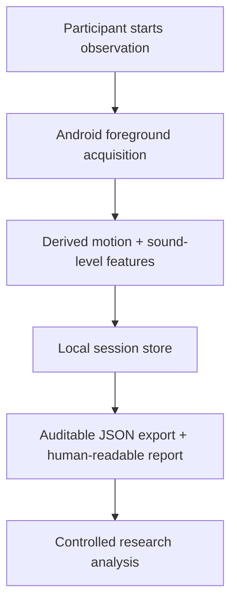

# ResilioSleep Research

**A local-first Android research instrument for auditable overnight rest-pattern acquisition.**

[](https://resiliosleep-research.imankhorrami.chatgpt.site/)
[](https://resiliosleep-research.imankhorrami.chatgpt.site/)
[](https://resiliosleep-research.imankhorrami.chatgpt.site/)
[](https://resiliosleep-research.imankhorrami.chatgpt.site/)

ResilioSleep is designed for research teams that need repeated, inspectable overnight observations without retaining raw audio or requiring participant data to flow through a consumer cloud account. It records device motion and derived ambient sound-level features, preserves coverage and continuity evidence, and exports auditable session summaries.

> **Claim boundary:** ResilioSleep does not measure clinical sleep stages, diagnose a disorder, or replace polysomnography, actigraphy, clinical evaluation, or an independent alarm. Its current outputs are technical rest-pattern summaries for feasibility research.

## Why this project exists

The project began from a practical contradiction: people willing to contribute repeated overnight observations are often asked to trust opaque systems with intimate behavioral data, while outputs can appear more clinically certain than the sensors justify. ResilioSleep takes a different path—local-first data handling, explicit provenance, visible missingness, and deliberately bounded claims.

## System boundary



- Raw audio and intelligible speech are not retained.
- Participant-level exports remain private and are never committed here.
- The production source repository, signing materials, and proprietary implementation remain private.
- This public repository contains only research-facing documentation, provenance, and collaboration materials.

## RC10 engineering evidence

| Gate | Evidence |
|---|---|
| Source freeze | Commit `0b3603f4edc815c494d0c1d8615f6104a9a139c7` |
| Automated verification | TypeScript, ESLint, 27 Jest suites / 223 tests |
| Native build | Android Debug and Release Kotlin compilation passed |
| Signed artifact | APK Signature Scheme v2; one signer; certificate continuity verified |
| Upgrade continuity | RC9 → RC10 in-place upgrade preserved History, latest session, setting, install identity, and data directory |
| Lifecycle reconciliation | Permission disruption and notification-stop paths produced terminal records without an observed duplicate ACTIVE record |
| Physical-device alarm | Screen-off, Airplane Mode, sound/vibration, Dismiss, and no-realert tested on Samsung SM-A155F / Android 15 |

The verified RC10 APK SHA-256 is:

```text
9C063A28ED0F63403FE7C531D6071F1987B0714C86792A14A9DD1B9553CE187C
```

## Research status

RC10 is suitable for a **bounded, supervised pilot candidate**, subject to the required ethics determination, consent process, retention plan, secure transfer route, and withdrawal procedure. Development evidence characterizes engineering feasibility; it is not clinical validation.

The current manuscript includes a provisional audit of supplied questionnaire exports. Eight records could be linked provisionally by a unique demographic key. No systematic short-term ISI change was observed; a small directional GAD-7 reduction was non-significant. The linkage and ethics/data-governance record must be confirmed before journal submission.

## Collaboration surface

We welcome focused academic collaboration in four areas:

1. validation against actigraphy or polysomnography;
2. calibration across Android devices and phone-placement protocols;
3. privacy-preserving derived-feature analysis;
4. reproducible feasibility-study design and missingness reporting.

For qualified academic review, controlled materials may include the signed evaluation APK, release hashes, lifecycle report, pilot protocol, and de-identified aggregate audit outputs. Production source, signing credentials, and participant-level data are not public.

## Public project page

The visual research overview, validation boundary, and roadmap are available at:

**https://resiliosleep-research.imankhorrami.chatgpt.site/**

## Citation

See [`CITATION.cff`](CITATION.cff). Until a peer-reviewed paper or DOI is assigned, cite the project page and the RC10 version.

## Rights and responsible use

This repository is a public documentation showcase, not an open-source release of the ResilioSleep application. See [`LICENSE.md`](LICENSE.md), [`SECURITY.md`](SECURITY.md), and [`CONTRIBUTING.md`](CONTRIBUTING.md).

